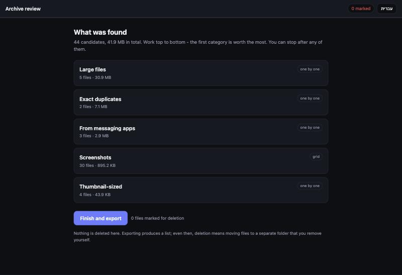
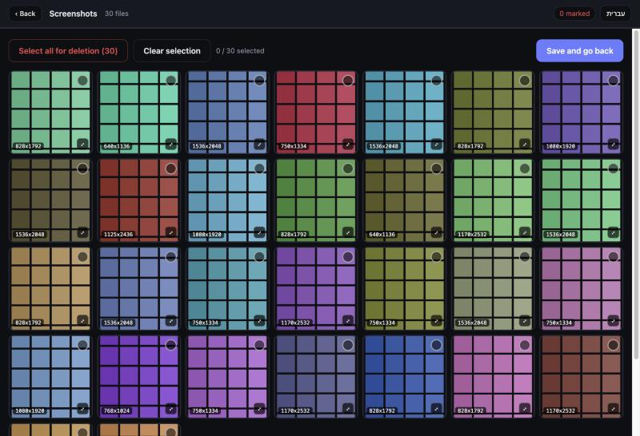

# archive-diet

Move a photo archive out of a cloud service you are leaving, and drop the dead
weight on the way out!

It is a [Claude Code](https://claude.com/claude-code) skill plus three small
Python scripts. Point it at a ZIP export from any cloud photo service and it
extracts it, verifies nothing was lost, works out which files are probably junk,
and hands you a local page to decide. Then it walks you through getting the
slimmer archive to wherever it is going, and verifying it landed before you
cancel anything.

**Nothing is ever deleted.** Approved files move to a folder you can browse.
You empty it yourself, at the end, once the new copy is verified.

**Nothing leaves your machine.** The review page is a **local HTML file** reading
images off your own disk. No server, no account, no upload. Cloud-to-cloud
transfer services route your family photos through their infrastructure; this
does not.

---

## Why it exists

I found an old cloud backup of mine that was about to be deleted, having photos going
back over a decade, the kind you cannot get again. I started paying for that
service to save them.

Which left me paying one more unnecessary subscription: that one, adding to the storage already
bundled with the devices I use. I paid to protect my memories and put it off, the way people do.

When I looked at it briefly, I've found that a lot of the content there was junk: screenshots,
duplicates, thumbnails, huge videos I would never watch. Moving it as-is would
have carried all of that into the cloud I was keeping, and pushed me toward a
bigger paid tier there too.

So the tool does both jobs at once. It migrates, and it slims.

---

## What it looks like

Candidates are grouped by why they were flagged, heaviest category first, so the
space you free drops off fastest at the start and you can stop whenever you like.



Categories with a handful of files are reviewed one at a time, with the video
player and enough room to actually look. Categories with hundreds become a
contact sheet, because clicking through six hundred cards is not reviewing.



*Both screenshots are of generated demo data, see below.*

The interface has an English / Hebrew toggle.

---

## How files get flagged

Every rule is a checkable fact about the file, never a guess about what the
picture shows. A wrong guess here costs somebody a memory.

| Category | Signal |
|---|---|
| Screenshots | Exact pixel dimensions matching a known phone or tablet screen |
| Exact duplicates | Identical SHA-256, compared only between files of identical byte length |
| Large files | Above a size threshold you set, biggest first |
| Thumbnail-sized | Tiny leftovers that are never photographs |
| Messaging / web | Filename patterns apps use when they save something |

The dimension rule is the one that earns its keep. Export tools often rename
every file to a plain timestamp, and once the original filename is gone, pixel
size is the only evidence left that a file came off a screen rather than a lens.

---

## Try it without risking anything

```bash
python3 scripts/make_demo.py ./demo-archive
python3 scripts/scan.py ./demo-archive --big-image 4
```

This generates a synthetic archive: colored gradients and flat panels, no real
images anywhere, with screenshots at genuine screen dimensions, duplicates,
oversized files and thumbnails, so every category populates. Walk the whole
workflow on it before pointing anything at your own photos.

Then open the `review.html` it prints. If the images do not appear, your browser
is refusing local file access; serve the folder instead:

```bash
cd demo-archive && python3 -m http.server 8790 --bind 127.0.0.1
```

---

## Using it for real

With Claude Code, the skill drives the whole thing. Describe what you are doing
and it will take you through export, extraction, verification, review, and the
move, stopping at each point that needs your decision.

To run the scripts directly:

```bash
# 1. look at the shape of the archive before deciding anything
python3 scripts/scan.py ARCHIVE_DIR --stats-only

# 2. generate the review page, with thresholds tuned to what you just saw
python3 scripts/scan.py ARCHIVE_DIR --big-video 100 --big-image 8

# 3. review in the browser, export decisions.json

# 4. see what would move
python3 scripts/apply.py ARCHIVE_DIR ~/Downloads/decisions.json

# 5. move it
python3 scripts/apply.py ARCHIVE_DIR ~/Downloads/decisions.json --apply

# changed your mind
python3 scripts/apply.py ARCHIVE_DIR --undo _pending-deletion_20260101-1200
```

`scan.py` only ever reads. `apply.py` only ever moves, and defaults to a dry run.

---

## Install as a skill

Copy the repository into your skills folder:

```bash
git clone https://github.com/YOUR-USERNAME/archive-diet.git ~/.claude/skills/archive-diet
```

Claude will pick it up from the next session.

---

## Requirements

Python 3.8 or newer, standard library only. No packages to install. A browser
for the review page. Works anywhere Python does; the migration guidance is
platform-agnostic, with notes where a specific destination behaves unusually.

---

## A word on what this does not do

It is not a backup tool and it does not make your archive safe. A synced cloud
folder is one copy that happens to appear in several places - delete a file and
it disappears everywhere. If the archive matters, keep a second copy that does
not sync. The skill will raise this at the point where it becomes relevant.

---

## License

MIT — see [LICENSE](LICENSE).
